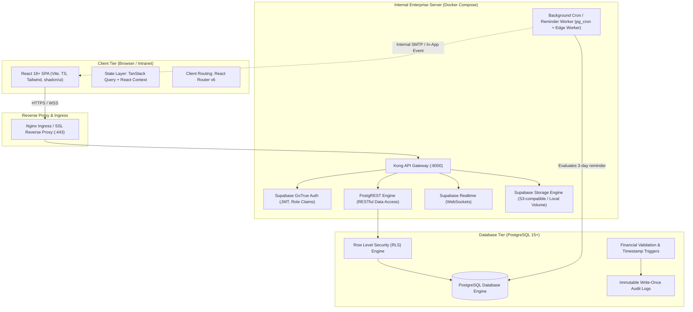
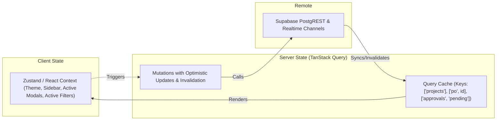
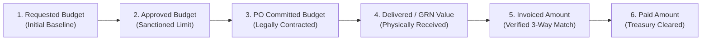
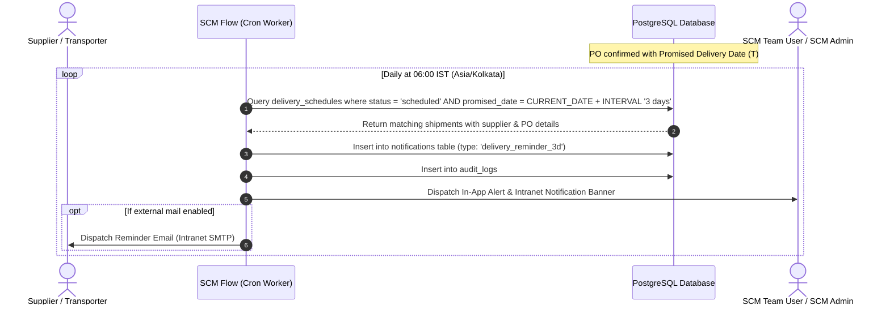

# SCM Flow — System Architecture Specification
**Document ID:** ARCH-SCM-001  
**Version:** 1.0.0 (Phase 0 Baseline)  
**Status:** Approved for Implementation Planning  
**Target Environment:** Internal Company Enterprise Server  
**Default Timezone:** `Asia/Kolkata` (IST, UTC+05:30)  
**Default Base Currency:** Indian Rupee (`INR` / `₹`)  

---

## 1. Executive Summary & Vision

**SCM Flow** is an enterprise-grade Supply Chain and Project Procurement Management System engineered specifically for capital and operational procurement workflows. Rooted in pharmaceutical, chemical, and advanced manufacturing operations, the system enforces rigid compliance, auditability, and financial governance across the complete lifecycle:

$$\text{Project Creation} \longrightarrow \text{Milestone Planning} \longrightarrow \text{Material BOM} \longrightarrow \text{Budget Approval} \longrightarrow \text{PR} \longrightarrow \text{PO} \longrightarrow \text{Supplier Confirmation} \longrightarrow \text{Delivery Tracking} \longrightarrow \text{GRN} \longrightarrow \text{Invoice 3-Way Match} \longrightarrow \text{Project Closure}$$

The application is architected around a decoupled **React + Vite + TypeScript** Single Page Application (SPA) frontend and a containerized **Supabase (PostgreSQL 15+)** backend deployed on internal corporate infrastructure.

---

## 2. High-Level Architecture Topology

The deployment is air-gapped or intranet-bound on an internal company server, ensuring zero leakage of proprietary formulation, project cost, or vendor pricing data.



---

## 3. Technology Stack Breakdown

| Layer | Technology | Selection Rationale |
| :--- | :--- | :--- |
| **Frontend Framework** | React 18+ with TypeScript | High-performance component model, strict typing across procurement models. |
| **Build Tooling** | Vite | Sub-second HMR, optimized production tree-shaking, fast internal builds. |
| **Routing** | React Router v6 | Declarative nested routing, route-level authorization guards, code splitting. |
| **Server State & Cache** | TanStack Query v5 | Automatic cache invalidation, optimistic updates, request deduplication. |
| **UI Components** | shadcn/ui + Radix UI Primitives | Accessible, zero-runtime overhead, unstyled primitives fully customizable via Tailwind. |
| **Styling** | Tailwind CSS v3 | Design token consistency, rapid enterprise UI composition, zero CSS bundle bloat. |
| **Form Management** | React Hook Form + Zod | High-performance uncontrolled forms, schema-driven validation, typed error boundaries. |
| **Backend Platform** | Supabase (PostgreSQL 15+) | Enterprise ACID compliance, robust RLS policies, native auth, real-time websockets. |
| **Data Access** | PostgREST + Supabase JS Client | Automatic OpenAPI-compliant REST endpoints with database-enforced security. |
| **Audit & Events** | PostgreSQL Triggers & `audit_logs` | Tamper-evident transaction logging for statutory and operational audits. |
| **Deployment Target** | Internal Linux Server (Docker) | Self-contained, zero cloud dependency, isolated corporate network topology. |

---

## 4. Frontend Application Architecture

The frontend is structured into domain-driven modules (features) to keep concerns cleanly segregated as the system scales.

```
frontend/
├── public/                     # Static assets, logos, favicon
├── src/
│   ├── assets/                 # Icons, illustration SVGs
│   ├── components/             # Reusable enterprise UI primitives
│   │   ├── feedback/           # Alert, Dialog, Toast, Progress, Skeleton
│   │   ├── forms/              # Input, Select, DatePicker, CurrencyInput, FileUpload
│   │   ├── layout/             # Sidebar, Header, Breadcrumbs, PageContainer, AppShell
│   │   ├── navigation/         # Tabs, Pagination, CommandPalette
│   │   └── tables/             # DataTable, ColumnHeader, TablePagination, RowActions
│   ├── config/                 # Application constants, menu definitions, currency & timezone
│   ├── context/                # AuthContext, ThemeContext, TenantContext
│   ├── features/               # Domain-driven feature packages
│   │   ├── approvals/          # Configurable workflow builder, pending queue, history
│   │   ├── budget/             # Budget requests, CAPEX/OPEX buckets, variance tracking
│   │   ├── delivery/           # Logistics, dispatch tracking, 3-day reminder schedule
│   │   ├── goods-receipt/      # GRN generation, QC inspection, batch/lot management
│   │   ├── invoices/           # Invoice registration, 3-way matching engine, approvals
│   │   ├── materials/          # Material master catalog (API, EXE, PM, Consumables)
│   │   ├── milestones/         # Milestone planner, dependencies, Gantt/Kanban view
│   │   ├── projects/           # Project workspace, summary, lifecycle management
│   │   ├── purchase-orders/    # PO creation, item distribution, PDF generation
│   │   ├── requisitions/       # PR drafting, multi-item consolidation, approvals
│   │   └── suppliers/          # Vendor master, contact cards, performance ratings
│   ├── hooks/                  # Global reusable hooks (useDebounce, useCurrency, etc.)
│   ├── lib/                    # Supabase client singleton, date formatting (date-fns), utils
│   ├── pages/                  # Top-level route pages wiring feature containers
│   ├── routes/                 # Protected routes, Role-based route guards
│   ├── services/               # Common API services, storage uploaders, export helpers
│   └── types/                  # Global TypeScript contracts and Supabase Database types
```

### 4.1 State Management Architecture



---

## 5. Security & Identity Architecture

### 5.1 Authentication Flow
1. Users authenticate via **Supabase Auth (GoTrue)** using email/password or corporate LDAP/Active Directory proxy.
2. GoTrue returns a signed JWT containing standard user claims and custom role metadata (`app_metadata.role`).
3. The frontend stores tokens securely and attaches the bearer token to all outgoing requests.
4. Database Row Level Security (RLS) inspects `auth.uid()` and reads the user's role and departmental scope from `public.user_roles`.

### 5.2 Role-Based Access Control (RBAC)
The system strictly enforces three distinct roles:
1. **Super Admin:** System-wide governance, user account provisioning, role assignment, master data configuration, system settings, global workflow override, immutable audit trail inspection.
2. **SCM Admin:** SCM department governance, approval workflow authoring (rules, thresholds, sequences), supplier onboarding and blacklisting, budget cap overrides, purchase order sign-off, system-wide procurement reporting.
3. **SCM Team User:** Daily operational execution—project creation, milestone tracking, material requirement identification, PR creation, delivery schedule management, GRN logging, and invoice preliminary entry.

### 5.3 Audit & Tamper-Evidence
- Every insert, update, and soft delete on critical entities (`budget_requests`, `purchase_orders`, `approval_steps`, `goods_receipt_notes`, `invoices`) triggers an automated write into the append-only `public.audit_logs` table.
- Logs capture `table_name`, `record_id`, `action`, `old_values` (JSONB), `new_values` (JSONB), `changed_by` (UUID), `ip_address`, and `created_at`.
- Strict RLS ensures no user—including SCM Admin—can update or delete records in `audit_logs`. Only Super Admin has read access.

---

## 6. Financial Architecture & Multi-Bucket Ledger

To prevent budget leakage and maintain financial clarity across multi-month project lifecycles, SCM Flow maintains five distinct financial buckets per project and milestone:

$$\begin{aligned}
\text{Requested Budget} &\ge \text{Approved Budget} \\
\text{Approved Budget} &\ge \text{PO Committed Amount} + \text{Uncommitted Allocation} \\
\text{PO Committed Amount} &\ge \text{Delivered Value (GRN)} \ge \text{Invoiced Amount} \ge \text{Paid Amount}
\end{aligned}$$



Financial calculations are stored in exact decimal types (`NUMERIC(15, 2)` or `NUMERIC(18, 4)`) to avoid IEEE 754 floating-point inaccuracies. Display currency is formatted according to the Indian Numbering System (`₹ 1,00,000.00`).

---

## 7. Delivery Logistics & 3-Day Reminder Architecture

A core operational SLA is the proactive **3-Calendar-Day Delivery Reminder** triggered before the agreed supplier dispatch/delivery date.



---

## 8. Integration Boundaries & Document Storage

### 8.1 Document Management (DMS)
- Purchase Requisitions, Supplier Quotations, PO PDF copies, Transporter Lorry Receipts (LR), Certificates of Analysis (COA), Delivery Challans, and Scanned Tax Invoices are stored in **Supabase Storage**.
- Buckets are partitioned:
  - `project-docs`: Technical specs, milestone drawings.
  - `procurement-docs`: Supplier quotes, comparative statements, signed POs.
  - `qa-qc-docs`: COAs, material test reports, quarantine rejection slips.
  - `finance-docs`: Vendor invoices, credit notes, payment receipts.
- All uploads are scanned, checksummed (SHA-256), and linked via the `documents` table with foreign keys to the parent business entity.

---

## 9. Architectural Decisions Log (ADR)

| Decision ID | Title | Status | Decision Summary |
| :--- | :--- | :--- | :--- |
| **ADR-001** | Use of Supabase on Internal Server | Confirmed | Deployed via official Docker Compose stack on internal server to ensure zero cloud dependence while leveraging PostgreSQL, RLS, and GoTrue. |
| **ADR-002** | Default Timezone & Currency | Confirmed | `Asia/Kolkata` (IST) timestamp handling and Indian Rupee (`INR` / `₹`) base ledger. All DB timestamps stored as `TIMESTAMPTZ`. |
| **ADR-003** | Material Categorization Scheme | Confirmed | Default master categories locked to `API`, `EXE`, `PM`, and `Consumables` reflecting pharmaceutical/chemical manufacturing requirements. |
| **ADR-004** | Immutable Approval Versioning | Confirmed | Approval rules are versioned. An inflight or completed approval request locks its workflow snapshot to prevent retrospective rule tampering. |
| **ADR-005** | Split PR/PO/GRN Allocation | Confirmed | A single project material requirement line item can be fulfilled across multiple PRs, split into multiple POs, and received across partial GRN deliveries. |

