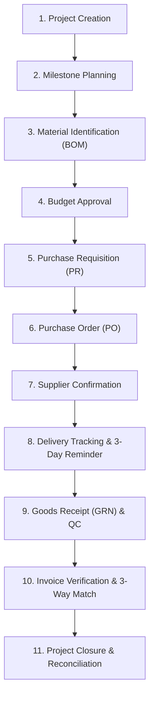

# SCM Flow — End-to-End Business Workflows & Lifecycle Governance
**Document ID:** BWF-SCM-003  
**Version:** 1.0.0 (Phase 0 Baseline)  
**Status:** Approved for Implementation Planning  
**Target Environment:** Internal Company Enterprise Server  
**Default Currency:** `INR` (`₹`)  
**Default Timezone:** `Asia/Kolkata` (IST, UTC+05:30)  
**Core Material Categories:** `API`, `EXE`, `PM`, `Consumables`  

---

## 1. End-to-End Procurement Lifecycle Overview

The complete SCM Flow lifecycle spans 11 discrete, tightly audited stages. Each stage transitions through defined states guarded by RBAC permissions, financial threshold approvals, and document verifications.

---

## 2. Stage-by-Stage Workflow Specifications

### 2.1 Stage 1: Project Creation
- **Primary Actor:** SCM Team User (Initiator) or SCM Admin.
- **Trigger:** Business need identified (e.g. new formulation batch, facility maintenance, clinical trial supply, analytical lab campaign).
- **Inputs:**
  - Project Title & Functional Description
  - Assigned Department (e.g. Formulations, Quality Control, Synthesis)
  - Project Lead / Manager
  - Target Start & Completion Dates
  - Preliminary Capital / Operational Expenditure Target
- **Business Validations:**
  - `target_completion_date` must be greater than or equal to `target_start_date`.
  - Project Code auto-generated using pattern: `PRJ-{YYYY}-{SEQUENTIAL_4_DIGITS}`.
  - Lifecycle statuses: `draft`, `planned`, `active`, `on_hold`, `completed`, `archived`.
  - Date normalization strictly uses Asia/Kolkata (IST, UTC+05:30) date-only boundaries (`YYYY-MM-DD`).
  - Delay calculation:
    - If status is `completed`: `delay = actual_completion_date - planned_end_date`.
    - If ongoing: `delay = max(0, today_IST - planned_end_date)`.
- **Outputs:** Created Project Record with baseline financial counters initialized to zero.

---

### 2.2 Stage 2: Milestone Planning
- **Primary Actor:** SCM Team User (Project Lead) or SCM Admin.
- **Trigger:** Project draft active.
- **Inputs:**
  - Sequential Milestone List (e.g. Milestone 1: Pilot Synthesis, Milestone 2: Stability Testing, Milestone 3: Scale-Up Packing).
  - Milestone Code: `MLS-{XX}` (e.g., MLS-01, MLS-02).
  - Target completion dates for each milestone.
  - Milestone-specific estimated budget allocation.
- **Business Validations:**
  - Sequence numbers must be strictly unique within the project.
  - Milestone planned dates must fall within project planned start and end dates.
  - Lifecycle statuses: `draft`, `planned`, `active`, `completed`, `delayed`, `archived`.
  - Progress calculation: `(Completed Milestones / Non-Archived Milestones) * 100`.
    - Archived milestones are strictly excluded from both numerator and denominator.
    - If non-archived milestone count is 0, progress is `null` and displayed as "No milestones".
- **Outputs:** Structured Work Breakdown Structure (WBS) ready for material assignment.

---

### 2.3 Stage 3: Material Identification (Bill of Materials / BOM)
- **Primary Actor:** SCM Team User / Technical Scientist.
- **Trigger:** Milestones established.
- **Inputs:**
  - Material Selection from Master Catalog (`material_masters`), categorized as:
    - **API (Active Pharmaceutical Ingredient):** Core therapeutic/chemical entities.
    - **EXE (Excipient):** Binders, solvents, stabilizers, preservatives.
    - **PM (Packaging Material):** Blister foils, HDPE bottles, cartons, tamper seals.
    - **Consumables:** Cleanroom PPE, analytical reagents, HPLC columns, filters.
  - Required Quantity and Unit of Measure (UOM: KG, Litre, Pack, etc.).
  - Required-by Date (needed on site).
  - Milestone Association (which milestone consumes this material).
  - Estimated Unit Cost (based on recent purchase history or budgetary quotes).
- **Business Validations:**
  - `required_quantity` > 0.
  - Calculation: $\text{Estimated Total Cost} = \text{Required Quantity} \times \text{Estimated Unit Rate}$.
  - System verifies whether material requires special storage (Cold Chain 2–8°C, Controlled Substance, Hazardous).
- **Outputs:** Project Bill of Materials (`project_materials`) in `unassigned` status.

---

### 2.4 Stage 4: Budget Approval
- **Primary Actors:** SCM Admin, Department Head, Finance Controller / Super Admin.
- **Trigger:** Project BOM finalized, budget request submitted.
- **Workflow Engine Mechanics:**
  - Dynamically routes to the active workflow version configured for `budget_request` and the project's department.
  - Multi-tier sequential approval based on requested amount (INR ₹):
    - **Tier 1 (Up to ₹ 5,00,000):** SCM Admin approval.
    - **Tier 2 (₹ 5,00,001 to ₹ 25,00,000):** SCM Admin $\to$ Department Head approval.
    - **Tier 3 (Above ₹ 25,00,000):** SCM Admin $\to$ Department Head $\to$ Super Admin / Executive sign-off.
- **Actions:**
  - **Approve:** Advances to next tier or transitions request to `approved`. Updates project `approved_budget`. Project status changes to `active` or `budget_approved`.
  - **Reject:** Requires mandatory remarks; transitions request to `rejected`. Returned to initiator for revision.
- **Outputs:** Locked `approved_budget` enabling downstream PR generation.

---

### 2.5 Stage 5: Purchase Requisition (PR)
- **Primary Actor:** SCM Team User.
- **Trigger:** Project budget approved; materials ready for procurement.
- **Split & Multi-Requisition Capability:**
  - A project material requirement of 1,000 KG can be split across multiple PRs (e.g., PR-01 for 300 KG pilot, PR-02 for 700 KG commercial).
  - Multiple materials from the same or different milestones can be consolidated into a single PR.
- **Validations:**
  - $\sum \text{PR Quantities} \le \text{Required Quantity}$ (over-requisitioning blocked unless authorized variance override flagged).
  - $\sum \text{PR Estimated Amounts} \le \text{Approved Project Budget}$.
- **Lifecycle States:** `draft` $\to$ `submitted` $\to$ `approved` $\to$ `partially_ordered` $\to$ `fully_ordered`.
- **Outputs:** Approved Purchase Requisition document ready for RFQ / Vendor PO allocation.

---

### 2.6 Stage 6: Purchase Order (PO)
- **Primary Actor:** SCM Admin (Sign-off) supported by SCM Team User (Drafter).
- **Trigger:** Approved PR items allocated to vetted vendor.
- **Inputs:**
  - Vendor Selection from active supplier registry (`suppliers`).
  - PO Line Items linked directly to `pr_items` and `project_materials`.
  - Negotiated Unit Rate, HSN/SAC Code, GST Rate (default 18%).
  - Commercial Terms: Payment terms (e.g. 30 days net), delivery terms (e.g. FOR Destination).
  - Target Dispatch and Expected Delivery Date.
- **Financial Commitment Tracking:**
  - On PO approval, the project's `po_committed_budget` increases by $\text{PO Total Amount}$.
  - System enforces: $\text{po_committed_budget} \le \text{approved_budget}$.
- **Outputs:** Formal Purchase Order document (`PO-{YYYY}-{XXXX}`) generated with PDF export and digital audit seal.

---

### 2.7 Stage 7: Supplier Confirmation
- **Primary Actor:** SCM Team User / SCM Admin (recording vendor acknowledgment).
- **Trigger:** Vendor receives PO and formally responds with sales order acknowledgment.
- **Inputs:**
  - Vendor Order / Confirmation Reference #.
  - Confirmation Date.
  - Promised Dispatch Date & Promised Delivery Date.
  - Acknowledged Unit Price and Total Value.
- **Discrepancy Check:**
  - If vendor promised delivery date is later than the project's `needed_by_date`, the system flags an automated **Critical Schedule Risk** badge on the project dashboard.
- **Outputs:** PO transitions to `confirmed` status; initial delivery schedule created.

---

### 2.8 Stage 8: Delivery Scheduling, Tracking & 3-Day Reminder
- **Primary Actor:** Automated System Worker & SCM Logistics Coordinator.
- **Trigger:** Approaching promised delivery date.
- **The Confirmed 3-Day Delivery Reminder Rule:**
  - Every day at 06:00 IST (`Asia/Kolkata`), an automated cron job evaluates:
    $$\text{Target Date} = \text{Current Date} + 3 \text{ calendar days}$$
  - Identifies all `delivery_schedules` where:
    $$\text{status} = \text{'scheduled'} \quad\text{AND}\quad \text{reminder_sent} = \text{false} \quad\text{AND}\quad \text{promised_delivery_date} = \text{Target Date}$$
  - Automatically dispatches in-app notifications and reminder emails to SCM team and vendor contact. Sets `reminder_sent = true` and `reminder_sent_at = now()`.
- **Shipment Tracking:**
  - When goods are dispatched, logistics records Transporter Name, Docket/LR Number, Vehicle Number, and GST E-Way Bill Number. Status updates to `in_transit`.
- **Outputs:** Proactive logistics coordination and zero unexpected warehouse delays.

---

### 2.9 Stage 9: Goods Receipt Notes (GRN) & Quality Control
- **Primary Actor:** Warehouse Inward Team & QC Chemist (SCM Team User / QA User).
- **Trigger:** Physical consignment arrives at security gate.
- **Process Steps:**
  1. **Gate Entry:** Gate officer records Vehicle Number, Challan Number, Date, and assigns Gate Entry #.
  2. **Physical Unloading & Count:** SCM User enters received quantity vs challan quantity. Material placed in **Quarantine Bay**.
  3. **Batch & QC Verification:**
     - For API, EXE, and PM: Batch/Lot Number, Manufacturing Date, Expiry Date recorded.
     - Certificate of Analysis (COA) uploaded to DMS and verified.
     - QC Chemist samples consignment: marks lines as `accepted`, `partially_rejected`, or `rejected`.
- **Inventory & Delivery Ledger Update:**
  - Accepted quantity increments `delivered_quantity` on `project_materials` and `po_items`.
  - Rejection triggers formal Quarantine Rejection Slip with mandatory defect remarks (damaged packaging, assay out of spec, foreign particles).
- **Outputs:** Final signed Goods Receipt Note (`GRN-{YYYY}-{XXXX}`) and QC Acceptance Certificate.

---

### 2.10 Stage 10: Invoice Verification & 3-Way Matching
- **Primary Actor:** SCM Admin & Finance User.
- **Trigger:** Supplier submits Commercial Tax Invoice.
- **Inputs:** Vendor Tax Invoice #, Date, Billed Quantities, Billed Unit Rates, GST Amount, Total Billed.
- **3-Way Matching Engine Logic:**
  Reconciliation compares three independent documents:
  1. **Purchase Order (PO):** Contracted Unit Rate & Agreed Terms.
  2. **Goods Receipt Note (GRN):** Physically Accepted & Quality-Passed Quantity.
  3. **Supplier Invoice:** Claimed Billed Quantity & Rate.

  $$\begin{aligned}
  \Delta Q &= \text{Invoice Billed Quantity} - \text{GRN Accepted Quantity} \\
  \Delta P &= \text{Invoice Unit Rate} - \text{PO Contracted Unit Rate} \\
  \Delta \text{Total} &= \text{Invoice Total Amount} - (\text{GRN Accepted Quantity} \times \text{PO Unit Rate} + \text{Applicable Tax})
  \end{aligned}$$

- **Tolerance Rules:**
  - $\Delta Q > 0$: Hard Stop (Cannot bill for more than accepted quantity).
  - $\Delta P > 0$: Held for Price Discrepancy (Requires SCM Admin debit note or approval).
  - Exact Match ($\Delta Q = 0, \Delta P = 0$): Automatically marked `matched` $\to$ `approved_for_payment`.
- **Ledger Update:** Project's `invoiced_budget` updated with verified invoice total.
- **Outputs:** Cleared Invoice ready for Treasury ERP payment processing.

---

### 2.11 Stage 11: Project Closure & Final Reconciliation
- **Primary Actor:** SCM Admin & Super Admin.
- **Trigger:** All project milestones completed and materials received/invoiced.
- **Pre-Closure Checklist:**
  - [x] All POs closed or cancelled (no pending open commitments).
  - [x] All physical GRNs inspected and moved from quarantine to active inventory.
  - [x] All vendor invoices registered and 3-way matched.
  - [x] Financial reconciliation:
    $$\text{Final Variance} = \text{Approved Budget} - \text{Total Invoiced / Paid Amount}$$
- **Closure Actions:**
  - Uncommitted budget released back to departmental pool.
  - Project status transitioned to `closed` (read-only archive).
- **Outputs:** Audit-sealed Project Closure Report signed by SCM Admin and Super Admin.

---

## 3. Confirmed Configuration Decisions Summary

| Configuration Parameter | Confirmed Value | Impact on Implementation |
| :--- | :--- | :--- |
| **Approval Workflows** | Configurable by Department, Amount, Approver, Sequence | Workflows are dynamic, multi-tier, and versioned. Hardcoded approval chains are strictly prohibited. |
| **Base Currency** | Indian Rupee (`INR` / `₹`) | Standard currency across all DB tables, forms, and reports. Indian numbering format (`₹ 1,00,000.00`) enforced in UI. |
| **Delivery Reminder SLA** | Exactly 3 Calendar Days | Automated daily cron job triggers alerts 3 days prior to `promised_delivery_date`. |
| **System Timezone** | `Asia/Kolkata` (IST, UTC+05:30) | All business deadlines, date math, cron triggers, and audit logs evaluate against IST. |
| **Target Deployment** | Company Internal Server | Self-contained on-premise Docker stack, zero third-party cloud data persistence. |
| **Default Material Categories** | `API`, `EXE`, `PM`, `Consumables` | Master catalog schema constrained to these four manufacturing categories. |

---

---

## 5. Phase 6: Supplier Master & Vendor Management Workflow

### 5.1 Supplier Lifecycle & Identification
- **Supplier Code:** System-generated immutable identifier (`SUP-XXXXXX`).
- **Entity Identification:** Legal entity name, trade display name, supplier type (`MANUFACTURER`, `DISTRIBUTOR`, `TRADER`, `SERVICE_PROVIDER`, `OEM`, `OTHER`), and tax/GST identifier.
- **Operational Status:**
  - `ACTIVE`: Vendor available for permitted operational use.
  - `INACTIVE`: Vendor deactivated with mandatory reason; cannot be selected for new material associations. Preserved in historical records.

### 5.2 Contacts & Physical Site Governance
- **Contacts:** Multiple contacts supported. Exactly one active primary contact is enforced per supplier via database partial unique index.
- **Addresses:** Multiple site addresses (Registered, Office, Manufacturing Site, Warehouse). At most one active primary address is enforced per address type per supplier.

### 5.3 Supplier-Material Associations
- Links approved suppliers to materials in the Material Catalog.
- Commercial parameters: Minimum Order Quantity (MOQ $> 0$), Lead Time in calendar days ($\ge 0$), supplier-specific grade or specification.
- Inactive suppliers are barred from forming new material associations.

### 5.4 Document Management & Expiry Tracking
- Secure storage of compliance records (Quality certifications, manufacturing licenses, incorporation, GST).
- Documents past `expiry_date` are automatically flagged as `EXPIRED`.
- Archiving requires mandatory justification.

### 5.5 Qualification Lifecycle
- Independent status: `NOT_STARTED`, `IN_PROGRESS`, `QUALIFIED`, `NOT_QUALIFIED`, `EXPIRED`.
- Transitions to `NOT_QUALIFIED` or `EXPIRED` mandate explicit reviewer notes.
- Historical transition evaluations are permanently recorded in `supplier_qualification_history`.

---

## 4. Assumptions & Open Decisions Log

To maintain technical transparency, open architectural questions and provisional assumptions are cataloged below:

| ID | Topic | Current Baseline Assumption | Open Decision Required from Stakeholders |
| :--- | :--- | :--- | :--- |
| **OD-001** | Multi-Currency Procurement | Baseline assumes all transactions are in `INR`. Foreign currency POs (e.g., USD/EUR for imported API) are converted at spot rate. | Will future phases require active multi-currency hedging and dual-currency invoice settlement? |
| **OD-002** | 3-Way Match Price Tolerance | Baseline requires exact price match ($\Delta P = 0$) or manual SCM Admin waiver. | Should a standard tolerance percentage (e.g. $\pm 0.5\%$ for freight adjustments) be automatically auto-cleared? |
| **OD-003** | ERP Integration (SAP / Tally) | Current baseline runs standalone with CSV/Excel export. | Will Phase 2 or 3 require bidirectional REST or database view synchronization with SAP S/4HANA or Tally Prime? |
| **OD-004** | Notification Delivery Channel | Baseline triggers In-App notification records; email requires intranet SMTP relay. | Is an internal SMTP relay configured, or should notification also integrate with internal MS Teams / WhatsApp Business? |
| **OD-005** | Batch Rejection / Return to Vendor (RTV) | Material rejected during QC GRN remains marked rejected in DB. | Is a dedicated Return-to-Vendor (RTV) gate pass and debit-note module required in Phase 6? |

