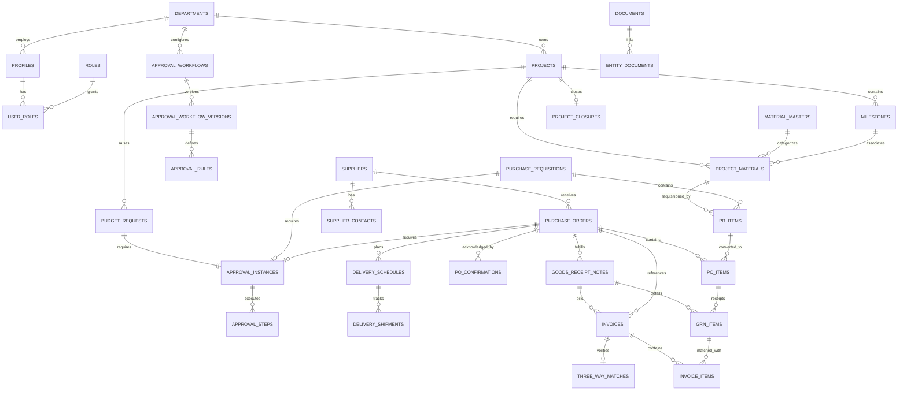

# SCM Flow — Database Architecture & Entity Design
**Document ID:** DBD-SCM-002  
**Version:** 1.0.0 (Phase 0 Baseline)  
**Database Engine:** PostgreSQL 15+ (Supabase)  
**Encoding:** `UTF8`  
**Collation:** `en_US.UTF-8`  
**Default Timestamp Policy:** `TIMESTAMPTZ` with `Asia/Kolkata` evaluation  

---

## 1. Design Principles & Normalization Baseline

The SCM Flow database is engineered to **Third Normal Form (3NF)** with deliberate operational denormalizations for aggregate financial ledgers to maintain strict transactional consistency, high-speed reporting, and complete audibility.

Key Database Principles:
1. **Immutable UUID Primary Keys:** All tables utilize `UUID DEFAULT gen_random_uuid()` to prevent enumeration attacks and support distributed/offline creation.
2. **Financial Precision:** Currency values use `NUMERIC(15, 2)` (or `NUMERIC(18, 4)` for unit prices and currency exchange calculations) to eliminate floating-point rounding errors. Default currency is `'INR'`.
3. **Audit Trail Immutability:** Destructive deletions are prohibited on business records; soft deletes (`deleted_at TIMESTAMPTZ`) are applied where appropriate, and all writes trigger append-only records in `audit_logs`.
4. **Historical Workflow Versioning:** Approval workflow rules are versioned (`approval_workflow_versions`). When a budget or procurement request enters review, it captures an immutable snapshot of the active workflow configuration.
5. **Multi-Split Material Procurement:** A single project material requirement (`project_materials`) can be broken down across multiple Purchase Requisitions (`pr_items`), which in turn can be split across multiple Purchase Orders (`po_items`), and received through multiple partial Goods Receipts (`grn_items`).

---

## 2. Entity-Relationship (ER) Diagram



---

## 3. Core Domain Entities & Table Specifications

### 3.1 Organization, Identity & RBAC

#### `departments`
Stores organizational business units (e.g., Formulations, API Synthesis, Quality Assurance, Procurement).
- `id` (UUID, PK)
- `name` (VARCHAR(100), UNIQUE, NOT NULL)
- `code` (VARCHAR(20), UNIQUE, NOT NULL)
- `head_user_id` (UUID, FK -> `profiles.id`, NULLABLE)
- `created_at` (TIMESTAMPTZ, DEFAULT now())

#### `profiles`
User profiles extending Supabase `auth.users`.
- `id` (UUID, PK, FK -> `auth.users.id` ON DELETE CASCADE)
- `email` (VARCHAR(255), UNIQUE, NOT NULL)
- `first_name` (VARCHAR(100), NOT NULL)
- `last_name` (VARCHAR(100), NOT NULL)
- `department_id` (UUID, FK -> `departments.id`)
- `phone` (VARCHAR(20))
- `is_active` (BOOLEAN, DEFAULT true)
- `created_at` (TIMESTAMPTZ, DEFAULT now())
- `updated_at` (TIMESTAMPTZ, DEFAULT now())

#### `roles`
Enumerated role definitions: `super_admin`, `scm_admin`, `scm_team_user`.
- `id` (VARCHAR(50), PK)
- `name` (VARCHAR(100), NOT NULL)
- `description` (TEXT)

#### `user_roles`
Mapping table linking profiles to roles.
- `id` (UUID, PK)
- `user_id` (UUID, FK -> `profiles.id` ON DELETE CASCADE, NOT NULL)
- `role_id` (VARCHAR(50), FK -> `roles.id` ON DELETE RESTRICT, NOT NULL)
- `assigned_by` (UUID, FK -> `profiles.id`)
- `created_at` (TIMESTAMPTZ, DEFAULT now())
- **Constraint:** UNIQUE(`user_id`, `role_id`)

---

### 3.2 Master Data: Materials & Suppliers

#### `material_masters`
Standardized catalog of materials used across manufacturing and R&D.
- `id` (UUID, PK)
- `material_code` (VARCHAR(50), UNIQUE, NOT NULL)
- `name` (VARCHAR(255), NOT NULL)
- `category` (ENUM `material_category`: `'API'`, `'EXE'`, `'PM'`, `'Consumables'`, NOT NULL)
- `description` (TEXT)
- `unit_of_measure` (VARCHAR(20), NOT NULL) — e.g. `'KG'`, `'LITRE'`, `'METRIC_TON'`, `'DRUM'`, `'PIECE'`, `'PACK'`
- `cas_number` (VARCHAR(50)) — Chemical Abstracts Service identifier (for API / chemical entities)
- `hsn_sac_code` (VARCHAR(20)) — Indian GST Harmonized System of Nomenclature code
- `standard_lead_time_days` (INTEGER, DEFAULT 14)
- `is_active` (BOOLEAN, DEFAULT true)
- `created_at` (TIMESTAMPTZ, DEFAULT now())
- `updated_at` (TIMESTAMPTZ, DEFAULT now())

#### `suppliers`
Vendor registry with compliance and tax parameters.
- `id` (UUID, PK)
- `vendor_code` (VARCHAR(50), UNIQUE, NOT NULL)
- `legal_name` (VARCHAR(255), NOT NULL)
- `trade_name` (VARCHAR(255))
- `gstin` (VARCHAR(15), UNIQUE) — 15-character Indian Goods & Services Tax ID
- `pan` (VARCHAR(10)) — Indian Permanent Account Number
- `email` (VARCHAR(255), NOT NULL)
- `phone` (VARCHAR(30))
- `address_line1` (TEXT, NOT NULL)
- `address_line2` (TEXT)
- `city` (VARCHAR(100), NOT NULL)
- `state` (VARCHAR(100), NOT NULL)
- `pincode` (VARCHAR(10), NOT NULL)
- `country` (VARCHAR(50), DEFAULT 'India')
- `msme_registered` (BOOLEAN, DEFAULT false)
- `payment_terms_days` (INTEGER, DEFAULT 30)
- `rating` (NUMERIC(3, 2), CHECK (rating BETWEEN 1.0 AND 5.0))
- `status` (ENUM `supplier_status`: `'active'`, `'on_hold'`, `'blacklisted'`, DEFAULT 'active')
- `created_at` (TIMESTAMPTZ, DEFAULT now())
- `updated_at` (TIMESTAMPTZ, DEFAULT now())

#### `supplier_contacts`
Key accounts and dispatch representatives for each supplier.
- `id` (UUID, PK)
- `supplier_id` (UUID, FK -> `suppliers.id` ON DELETE CASCADE)
- `name` (VARCHAR(100), NOT NULL)
- `designation` (VARCHAR(100))
- `email` (VARCHAR(255), NOT NULL)
- `mobile` (VARCHAR(30), NOT NULL)
- `is_primary` (BOOLEAN, DEFAULT false)

---

### 3.3 Projects, Milestones & Material Requirements

#### `projects`
Core project boundary entity tracking financial commitments and milestone schedules.
- `id` (UUID, PK)
- `project_code` (VARCHAR(50), UNIQUE, NOT NULL) — e.g. `'PRJ-2026-001'`
- `title` (VARCHAR(255), NOT NULL)
- `description` (TEXT)
- `department_id` (UUID, FK -> `departments.id`, NOT NULL)
- `lead_user_id` (UUID, FK -> `profiles.id`, NOT NULL)
- `status` (ENUM `project_status`: `'draft'`, `'planned'`, `'budget_approved'`, `'active'`, `'completed'`, `'closed'`, `'cancelled'`, DEFAULT 'draft')
- `target_start_date` (DATE, NOT NULL)
- `target_completion_date` (DATE, NOT NULL)
- `actual_completion_date` (DATE)
- `currency` (VARCHAR(3), DEFAULT 'INR', NOT NULL)
- `requested_budget` (NUMERIC(15, 2), DEFAULT 0.00, NOT NULL)
- `approved_budget` (NUMERIC(15, 2), DEFAULT 0.00, NOT NULL)
- `po_committed_budget` (NUMERIC(15, 2), DEFAULT 0.00, NOT NULL)
- `invoiced_budget` (NUMERIC(15, 2), DEFAULT 0.00, NOT NULL)
- `paid_budget` (NUMERIC(15, 2), DEFAULT 0.00, NOT NULL)
- `created_by` (UUID, FK -> `profiles.id`, NOT NULL)
- `created_at` (TIMESTAMPTZ, DEFAULT now())
- `updated_at` (TIMESTAMPTZ, DEFAULT now())

#### `milestones`
Phased execution schedule within a project.
- `id` (UUID, PK)
- `project_id` (UUID, FK -> `projects.id` ON DELETE CASCADE, NOT NULL)
- `sequence_number` (INTEGER, NOT NULL)
- `title` (VARCHAR(255), NOT NULL)
- `description` (TEXT)
- `target_date` (DATE, NOT NULL)
- `actual_completion_date` (DATE)
- `estimated_budget` (NUMERIC(15, 2), DEFAULT 0.00, NOT NULL)
- `status` (ENUM `milestone_status`: `'pending'`, `'in_progress'`, `'completed'`, `'delayed'`, DEFAULT 'pending')
- `created_at` (TIMESTAMPTZ, DEFAULT now())
- `updated_at` (TIMESTAMPTZ, DEFAULT now())
- **Constraint:** UNIQUE(`project_id`, `sequence_number`)

#### `project_materials` (Bill of Materials / Requisition Requirement)
Material requirements planned per project/milestone.
- `id` (UUID, PK)
- `project_id` (UUID, FK -> `projects.id` ON DELETE CASCADE, NOT NULL)
- `milestone_id` (UUID, FK -> `milestones.id` ON DELETE SET NULL)
- `material_master_id` (UUID, FK -> `material_masters.id` ON DELETE RESTRICT, NOT NULL)
- `required_quantity` (NUMERIC(12, 3), CHECK (required_quantity > 0), NOT NULL)
- `estimated_unit_rate` (NUMERIC(15, 2), CHECK (estimated_unit_rate >= 0), NOT NULL)
- `estimated_total_cost` (NUMERIC(15, 2), GENERATED ALWAYS AS (required_quantity * estimated_unit_rate) STORED)
- `currency` (VARCHAR(3), DEFAULT 'INR', NOT NULL)
- `needed_by_date` (DATE, NOT NULL)
- `requisitioned_quantity` (NUMERIC(12, 3), DEFAULT 0.000, NOT NULL) — Sum of PR item quantities
- `ordered_quantity` (NUMERIC(12, 3), DEFAULT 0.000, NOT NULL) — Sum of PO item quantities
- `delivered_quantity` (NUMERIC(12, 3), DEFAULT 0.000, NOT NULL) — Sum of GRN accepted quantities
- `status` (ENUM `material_req_status`: `'unassigned'`, `'partially_requisitioned'`, `'fully_requisitioned'`, `'partially_ordered'`, `'fully_ordered'`, `'delivered'`, DEFAULT 'unassigned')
- `technical_specification` (TEXT)
- `created_at` (TIMESTAMPTZ, DEFAULT now())
- `updated_at` (TIMESTAMPTZ, DEFAULT now())

---

### 3.4 Configurable Approvals & Budget Requests

#### `approval_workflows`
Master configuration of approval definitions by department and entity type.
- `id` (UUID, PK)
- `name` (VARCHAR(150), NOT NULL)
- `department_id` (UUID, FK -> `departments.id`, NULLABLE) — NULL applies as global fallback
- `entity_type` (ENUM `approval_entity_type`: `'budget_request'`, `'purchase_requisition'`, `'purchase_order'`, `'project_closure'`, NOT NULL)
- `is_active` (BOOLEAN, DEFAULT true)
- `created_at` (TIMESTAMPTZ, DEFAULT now())

#### `approval_workflow_versions`
Immutable historical versions of workflow structures.
- `id` (UUID, PK)
- `workflow_id` (UUID, FK -> `approval_workflows.id` ON DELETE CASCADE, NOT NULL)
- `version_number` (INTEGER, NOT NULL)
- `effective_from` (TIMESTAMPTZ, DEFAULT now(), NOT NULL)
- `effective_to` (TIMESTAMPTZ)
- `created_by` (UUID, FK -> `profiles.id`, NOT NULL)
- `notes` (TEXT)
- **Constraint:** UNIQUE(`workflow_id`, `version_number`)

#### `approval_rules`
Individual tiered steps configured within a workflow version.
- `id` (UUID, PK)
- `workflow_version_id` (UUID, FK -> `approval_workflow_versions.id` ON DELETE CASCADE, NOT NULL)
- `step_order` (INTEGER, NOT NULL) — 1, 2, 3...
- `min_amount` (NUMERIC(15, 2), DEFAULT 0.00, NOT NULL)
- `max_amount` (NUMERIC(15, 2)) — NULL represents positive infinity (any amount above min)
- `approver_role_id` (VARCHAR(50), FK -> `roles.id`, NULLABLE)
- `specific_approver_id` (UUID, FK -> `profiles.id`, NULLABLE)
- `escalation_timeout_hours` (INTEGER, DEFAULT 48)
- **Constraint:** CHECK (`approver_role_id` IS NOT NULL OR `specific_approver_id` IS NOT NULL)

#### `approval_instances`
Execution instances attached to a specific transaction.
- `id` (UUID, PK)
- `entity_type` (ENUM `approval_entity_type`, NOT NULL)
- `entity_id` (UUID, NOT NULL) — ID of budget_request, PR, PO, or Project
- `workflow_version_id` (UUID, FK -> `approval_workflow_versions.id` ON DELETE RESTRICT, NOT NULL)
- `current_step_order` (INTEGER, DEFAULT 1, NOT NULL)
- `status` (ENUM `approval_status`: `'pending'`, `'in_progress'`, `'approved'`, `'rejected'`, `'cancelled'`, DEFAULT 'pending')
- `initiated_by` (UUID, FK -> `profiles.id`, NOT NULL)
- `created_at` (TIMESTAMPTZ, DEFAULT now())
- `updated_at` (TIMESTAMPTZ, DEFAULT now())

#### `approval_steps`
Historical audit log of each individual approver's action.
- `id` (UUID, PK)
- `instance_id` (UUID, FK -> `approval_instances.id` ON DELETE CASCADE, NOT NULL)
- `step_order` (INTEGER, NOT NULL)
- `approver_user_id` (UUID, FK -> `profiles.id`, NOT NULL)
- `status` (ENUM `approval_step_status`: `'pending'`, `'approved'`, `'rejected'`, `'skipped'`, DEFAULT 'pending')
- `comments` (TEXT)
- `action_timestamp` (TIMESTAMPTZ)
- `created_at` (TIMESTAMPTZ, DEFAULT now())

#### `budget_requests`
Explicit project budget authorization requests.
- `id` (UUID, PK)
- `project_id` (UUID, FK -> `projects.id` ON DELETE CASCADE, NOT NULL)
- `request_number` (VARCHAR(50), UNIQUE, NOT NULL) — e.g. `'BR-2026-0001'`
- `requested_amount` (NUMERIC(15, 2), CHECK (requested_amount > 0), NOT NULL)
- `approved_amount` (NUMERIC(15, 2))
- `currency` (VARCHAR(3), DEFAULT 'INR', NOT NULL)
- `justification` (TEXT, NOT NULL)
- `status` (ENUM `budget_request_status`: `'draft'`, `'submitted'`, `'approved'`, `'rejected'`, DEFAULT 'draft')
- `submitted_by` (UUID, FK -> `profiles.id`, NOT NULL)
- `approved_by` (UUID, FK -> `profiles.id`)
- `created_at` (TIMESTAMPTZ, DEFAULT now())
- `updated_at` (TIMESTAMPTZ, DEFAULT now())

---

### 3.5 Procurement Execution: PR, PO & Confirmations

#### `purchase_requisitions`
Purchase Requisition (PR) headers drafted by SCM Team Users.
- `id` (UUID, PK)
- `pr_number` (VARCHAR(50), UNIQUE, NOT NULL) — e.g. `'PR-2026-0001'`
- `project_id` (UUID, FK -> `projects.id` ON DELETE RESTRICT, NOT NULL)
- `department_id` (UUID, FK -> `departments.id`, NOT NULL)
- `status` (ENUM `pr_status`: `'draft'`, `'submitted'`, `'approved'`, `'partially_ordered'`, `'fully_ordered'`, `'cancelled'`, DEFAULT 'draft')
- `urgency` (ENUM `priority_level`: `'low'`, `'normal'`, `'high'`, `'urgent'`, DEFAULT 'normal')
- `total_estimated_amount` (NUMERIC(15, 2), DEFAULT 0.00, NOT NULL)
- `currency` (VARCHAR(3), DEFAULT 'INR', NOT NULL)
- `purpose` (TEXT, NOT NULL)
- `created_by` (UUID, FK -> `profiles.id`, NOT NULL)
- `created_at` (TIMESTAMPTZ, DEFAULT now())
- `updated_at` (TIMESTAMPTZ, DEFAULT now())

#### `pr_items`
Individual line items within a Purchase Requisition.
- `id` (UUID, PK)
- `pr_id` (UUID, FK -> `purchase_requisitions.id` ON DELETE CASCADE, NOT NULL)
- `project_material_id` (UUID, FK -> `project_materials.id` ON DELETE RESTRICT, NOT NULL)
- `quantity` (NUMERIC(12, 3), CHECK (quantity > 0), NOT NULL)
- `estimated_rate` (NUMERIC(15, 2), NOT NULL)
- `estimated_amount` (NUMERIC(15, 2), GENERATED ALWAYS AS (quantity * estimated_rate) STORED)
- `ordered_quantity` (NUMERIC(12, 3), DEFAULT 0.000, NOT NULL)
- `technical_notes` (TEXT)
- `created_at` (TIMESTAMPTZ, DEFAULT now())

#### `purchase_orders`
Legally binding Purchase Orders (PO) issued to suppliers.
- `id` (UUID, PK)
- `po_number` (VARCHAR(50), UNIQUE, NOT NULL) — e.g. `'PO-2026-0001'`
- `project_id` (UUID, FK -> `projects.id` ON DELETE RESTRICT, NOT NULL)
- `supplier_id` (UUID, FK -> `suppliers.id` ON DELETE RESTRICT, NOT NULL)
- `supplier_contact_id` (UUID, FK -> `supplier_contacts.id`)
- `status` (ENUM `po_status`: `'draft'`, `'pending_approval'`, `'approved'`, `'issued'`, `'confirmed'`, `'partially_delivered'`, `'fully_delivered'`, `'closed'`, `'cancelled'`, DEFAULT 'draft')
- `subtotal_amount` (NUMERIC(15, 2), DEFAULT 0.00, NOT NULL)
- `tax_amount` (NUMERIC(15, 2), DEFAULT 0.00, NOT NULL)
- `total_amount` (NUMERIC(15, 2), DEFAULT 0.00, NOT NULL)
- `currency` (VARCHAR(3), DEFAULT 'INR', NOT NULL)
- `payment_terms` (TEXT, NOT NULL)
- `delivery_terms` (TEXT, NOT NULL) — e.g. `'FOR Destination / Ex-Works'`
- `issued_date` (DATE)
- `expected_delivery_date` (DATE, NOT NULL)
- `created_by` (UUID, FK -> `profiles.id`, NOT NULL)
- `approved_by` (UUID, FK -> `profiles.id`)
- `created_at` (TIMESTAMPTZ, DEFAULT now())
- `updated_at` (TIMESTAMPTZ, DEFAULT now())

#### `po_items`
Detailed lines linking back to PR items and project materials.
- `id` (UUID, PK)
- `po_id` (UUID, FK -> `purchase_orders.id` ON DELETE CASCADE, NOT NULL)
- `pr_item_id` (UUID, FK -> `pr_items.id` ON DELETE RESTRICT, NOT NULL)
- `project_material_id` (UUID, FK -> `project_materials.id` ON DELETE RESTRICT, NOT NULL)
- `quantity` (NUMERIC(12, 3), CHECK (quantity > 0), NOT NULL)
- `unit_rate` (NUMERIC(15, 2), CHECK (unit_rate >= 0), NOT NULL)
- `tax_rate_percent` (NUMERIC(5, 2), DEFAULT 18.00, NOT NULL) — Default GST rate
- `tax_amount` (NUMERIC(15, 2), GENERATED ALWAYS AS ((quantity * unit_rate) * (tax_rate_percent / 100.0)) STORED)
- `line_total` (NUMERIC(15, 2), GENERATED ALWAYS AS ((quantity * unit_rate) + ((quantity * unit_rate) * (tax_rate_percent / 100.0))) STORED)
- `delivered_quantity` (NUMERIC(12, 3), DEFAULT 0.000, NOT NULL)
- `invoiced_quantity` (NUMERIC(12, 3), DEFAULT 0.000, NOT NULL)
- `created_at` (TIMESTAMPTZ, DEFAULT now())

#### `po_confirmations`
Formal vendor order acknowledgment.
- `id` (UUID, PK)
- `po_id` (UUID, FK -> `purchase_orders.id` ON DELETE CASCADE, NOT NULL)
- `confirmation_reference` (VARCHAR(100), NOT NULL) — Vendor Sales Order #
- `confirmed_date` (DATE, NOT NULL)
- `promised_dispatch_date` (DATE, NOT NULL)
- `promised_delivery_date` (DATE, NOT NULL)
- `acknowledged_total_amount` (NUMERIC(15, 2), NOT NULL)
- `notes` (TEXT)
- `confirmed_by_name` (VARCHAR(100), NOT NULL)
- `recorded_by` (UUID, FK -> `profiles.id`, NOT NULL)
- `created_at` (TIMESTAMPTZ, DEFAULT now())

---

### 3.6 Logistics, Delivery Schedules & 3-Day Reminders

#### `delivery_schedules`
Logistical shipment schedule tracking shipments against purchase orders.
- `id` (UUID, PK)
- `po_id` (UUID, FK -> `purchase_orders.id` ON DELETE CASCADE, NOT NULL)
- `schedule_number` (INTEGER, NOT NULL) — 1, 2, 3 for split shipments
- `planned_quantity` (NUMERIC(12, 3), NOT NULL)
- `promised_delivery_date` (DATE, NOT NULL)
- `reminder_trigger_date` (DATE, GENERATED ALWAYS AS (promised_delivery_date - INTERVAL '3 days') STORED)
- `reminder_sent` (BOOLEAN, DEFAULT false, NOT NULL)
- `reminder_sent_at` (TIMESTAMPTZ)
- `status` (ENUM `delivery_schedule_status`: `'scheduled'`, `'reminder_dispatched'`, `'in_transit'`, `'delivered'`, `'delayed'`, `'cancelled'`, DEFAULT 'scheduled')
- `created_at` (TIMESTAMPTZ, DEFAULT now())
- `updated_at` (TIMESTAMPTZ, DEFAULT now())

#### `delivery_shipments`
Physical consignment dispatch details.
- `id` (UUID, PK)
- `delivery_schedule_id` (UUID, FK -> `delivery_schedules.id` ON DELETE CASCADE, NOT NULL)
- `transporter_name` (VARCHAR(150), NOT NULL)
- `docket_lr_number` (VARCHAR(100), NOT NULL) — Lorry Receipt or Tracking #
- `dispatch_date` (DATE, NOT NULL)
- `vehicle_number` (VARCHAR(30))
- `e_way_bill_number` (VARCHAR(50)) — Indian GST E-Way Bill Number
- `driver_contact` (VARCHAR(30))
- `status` (ENUM `shipment_status`: `'dispatched'`, `'in_transit'`, `'at_gate'`, `'unloaded'`, DEFAULT 'dispatched')
- `created_at` (TIMESTAMPTZ, DEFAULT now())

---

### 3.7 Goods Receipt Notes (GRN) & Quality Inspection

#### `goods_receipt_notes`
Physical arrival and initial warehouse inspection recording.
- `id` (UUID, PK)
- `grn_number` (VARCHAR(50), UNIQUE, NOT NULL) — e.g. `'GRN-2026-0001'`
- `po_id` (UUID, FK -> `purchase_orders.id` ON DELETE RESTRICT, NOT NULL)
- `supplier_challan_number` (VARCHAR(100), NOT NULL)
- `challan_date` (DATE, NOT NULL)
- `received_date` (DATE, NOT NULL)
- `gate_entry_number` (VARCHAR(50), NOT NULL)
- `received_by_user_id` (UUID, FK -> `profiles.id`, NOT NULL)
- `qc_status` (ENUM `qc_inspection_status`: `'quarantine'`, `'under_testing'`, `'accepted'`, `'partially_rejected'`, `'rejected'`, DEFAULT 'quarantine')
- `overall_status` (ENUM `grn_status`: `'draft'`, `'submitted'`, `'qc_completed'`, `'closed'`, DEFAULT 'draft')
- `storage_location` (VARCHAR(100), NOT NULL) — e.g. `'Warehouse-A / Bay-3'`
- `created_at` (TIMESTAMPTZ, DEFAULT now())
- `updated_at` (TIMESTAMPTZ, DEFAULT now())

#### `grn_items`
Line item quantities received, sampled, accepted, or rejected.
- `id` (UUID, PK)
- `grn_id` (UUID, FK -> `goods_receipt_notes.id` ON DELETE CASCADE, NOT NULL)
- `po_item_id` (UUID, FK -> `po_items.id` ON DELETE RESTRICT, NOT NULL)
- `batch_lot_number` (VARCHAR(100), NOT NULL)
- `manufacturer_date` (DATE)
- `expiry_date` (DATE)
- `challan_quantity` (NUMERIC(12, 3), NOT NULL)
- `received_quantity` (NUMERIC(12, 3), NOT NULL)
- `accepted_quantity` (NUMERIC(12, 3), DEFAULT 0.000, NOT NULL)
- `rejected_quantity` (NUMERIC(12, 3), DEFAULT 0.000, NOT NULL)
- `rejection_reason` (TEXT)
- `coa_verified` (BOOLEAN, DEFAULT false, NOT NULL) — Certificate of Analysis match
- `created_at` (TIMESTAMPTZ, DEFAULT now())

---

### 3.8 Invoice Verification & 3-Way Matching

#### `invoices`
Supplier tax invoice records submitted for clearance.
- `id` (UUID, PK)
- `invoice_number` (VARCHAR(100), NOT NULL) — Vendor Tax Invoice #
- `supplier_id` (UUID, FK -> `suppliers.id` ON DELETE RESTRICT, NOT NULL)
- `po_id` (UUID, FK -> `purchase_orders.id` ON DELETE RESTRICT, NOT NULL)
- `invoice_date` (DATE, NOT NULL)
- `received_date` (DATE, NOT NULL)
- `currency` (VARCHAR(3), DEFAULT 'INR', NOT NULL)
- `subtotal_amount` (NUMERIC(15, 2), NOT NULL)
- `tax_amount` (NUMERIC(15, 2), NOT NULL)
- `total_amount` (NUMERIC(15, 2), NOT NULL)
- `due_date` (DATE, NOT NULL)
- `verification_status` (ENUM `invoice_verification_status`: `'unverified'`, `'matched'`, `'discrepancy'`, `'approved_for_payment'`, `'paid'`, `'rejected'`, DEFAULT 'unverified')
- `entered_by` (UUID, FK -> `profiles.id`, NOT NULL)
- `verified_by` (UUID, FK -> `profiles.id`)
- `created_at` (TIMESTAMPTZ, DEFAULT now())
- `updated_at` (TIMESTAMPTZ, DEFAULT now())
- **Constraint:** UNIQUE(`supplier_id`, `invoice_number`)

#### `invoice_items`
Billed items mapped to PO items and GRN receipts.
- `id` (UUID, PK)
- `invoice_id` (UUID, FK -> `invoices.id` ON DELETE CASCADE, NOT NULL)
- `po_item_id` (UUID, FK -> `po_items.id` ON DELETE RESTRICT, NOT NULL)
- `grn_item_id` (UUID, FK -> `grn_items.id` ON DELETE RESTRICT, NULLABLE)
- `billed_quantity` (NUMERIC(12, 3), NOT NULL)
- `unit_rate` (NUMERIC(15, 2), NOT NULL)
- `tax_rate_percent` (NUMERIC(5, 2), NOT NULL)
- `tax_amount` (NUMERIC(15, 2), NOT NULL)
- `line_total` (NUMERIC(15, 2), NOT NULL)
- `created_at` (TIMESTAMPTZ, DEFAULT now())

#### `three_way_matches`
Formal reconciliation record among PO, GRN, and Invoice.
- `id` (UUID, PK)
- `invoice_id` (UUID, FK -> `invoices.id` ON DELETE CASCADE, UNIQUE, NOT NULL)
- `po_id` (UUID, FK -> `purchase_orders.id` ON DELETE RESTRICT, NOT NULL)
- `grn_id` (UUID, FK -> `goods_receipt_notes.id` ON DELETE RESTRICT, NOT NULL)
- `po_total_amount` (NUMERIC(15, 2), NOT NULL)
- `grn_accepted_value` (NUMERIC(15, 2), NOT NULL)
- `invoice_total_amount` (NUMERIC(15, 2), NOT NULL)
- `quantity_variance` (NUMERIC(12, 3), NOT NULL) — (Billed Qty - Accepted Qty)
- `price_variance` (NUMERIC(15, 2), NOT NULL) — (Billed Rate - PO Rate)
- `total_variance_amount` (NUMERIC(15, 2), NOT NULL)
- `is_within_tolerance` (BOOLEAN, NOT NULL) — Evaluated against corporate tolerance thresholds
- `matched_status` (ENUM `match_status`: `'exact_match'`, `'tolerance_accepted'`, `'discrepancy_held'`, NOT NULL)
- `reconciliation_remarks` (TEXT)
- `matched_by` (UUID, FK -> `profiles.id`, NOT NULL)
- `matched_at` (TIMESTAMPTZ, DEFAULT now(), NOT NULL)

---

### 3.9 Project Closure, Documents, Notifications & Auditing

#### `project_closures`
Project sign-off and final variance documentation.
- `id` (UUID, PK)
- `project_id` (UUID, FK -> `projects.id` ON DELETE CASCADE, UNIQUE, NOT NULL)
- `total_budget_sanctioned` (NUMERIC(15, 2), NOT NULL)
- `total_po_committed` (NUMERIC(15, 2), NOT NULL)
- `total_grn_value` (NUMERIC(15, 2), NOT NULL)
- `total_invoiced` (NUMERIC(15, 2), NOT NULL)
- `total_paid` (NUMERIC(15, 2), NOT NULL)
- `budget_savings_or_overrun` (NUMERIC(15, 2), NOT NULL)
- `unfulfilled_pos_cleared` (BOOLEAN, DEFAULT false, NOT NULL)
- `inventory_reconciled` (BOOLEAN, DEFAULT false, NOT NULL)
- `closure_summary` (TEXT, NOT NULL)
- `closed_by` (UUID, FK -> `profiles.id`, NOT NULL)
- `closed_at` (TIMESTAMPTZ, DEFAULT now(), NOT NULL)

#### `documents` & `entity_documents`
Unified document indexing linked to Supabase Storage objects.
- `documents`: `id` (UUID, PK), `storage_bucket` (VARCHAR(100)), `storage_path` (TEXT), `file_name` (VARCHAR(255)), `file_size_bytes` (BIGINT), `mime_type` (VARCHAR(100)), `sha256_checksum` (VARCHAR(64)), `uploaded_by` (UUID), `created_at` (TIMESTAMPTZ)
- `entity_documents`: `id` (UUID, PK), `document_id` (UUID, FK -> `documents.id`), `entity_type` (VARCHAR(50)), `entity_id` (UUID), `document_tag` (VARCHAR(50)) — e.g. `'PO_SIGNED'`, `'COA'`, `'TAX_INVOICE'`, `'CHALLAN'`

#### `notifications`
In-app alerts and delivery reminder delivery events.
- `id` (UUID, PK)
- `recipient_user_id` (UUID, FK -> `profiles.id` ON DELETE CASCADE, NOT NULL)
- `notification_type` (VARCHAR(50), NOT NULL) — e.g. `'DELIVERY_REMINDER_3D'`, `'APPROVAL_REQUIRED'`, `'VARIANCE_FLAGGED'`
- `title` (VARCHAR(255), NOT NULL)
- `message` (TEXT, NOT NULL)
- `related_entity_type` (VARCHAR(50))
- `related_entity_id` (UUID)
- `is_read` (BOOLEAN, DEFAULT false, NOT NULL)
- `created_at` (TIMESTAMPTZ, DEFAULT now())

#### `audit_logs`
Write-once immutable transaction ledger.
- `id` (BIGSERIAL, PK)
- `table_name` (VARCHAR(100), NOT NULL)
- `record_id` (UUID, NOT NULL)
- `action` (VARCHAR(20), NOT NULL) — `'INSERT'`, `'UPDATE'`, `'DELETE'`, `'SOFT_DELETE'`
- `old_values` (JSONB)
- `new_values` (JSONB)
- `changed_by` (UUID, FK -> `profiles.id`)
- `ip_address` (INET)
- `user_agent` (TEXT)
- `created_at` (TIMESTAMPTZ, DEFAULT now(), NOT NULL)

---

## 4. Key Indexes & Performance Optimization

```sql
-- Indexes for active project querying
CREATE INDEX idx_projects_status ON public.projects(status);
CREATE INDEX idx_projects_department ON public.projects(department_id);

-- Indexes for Material lookup and BOM mapping
CREATE INDEX idx_project_materials_project ON public.project_materials(project_id);
CREATE INDEX idx_project_materials_material ON public.project_materials(material_master_id);
CREATE INDEX idx_material_masters_category ON public.material_masters(category);

-- Indexes for Procurement and PR/PO joins
CREATE INDEX idx_pr_project ON public.purchase_requisitions(project_id);
CREATE INDEX idx_pr_items_pr ON public.pr_items(pr_id);
CREATE INDEX idx_pr_items_material ON public.pr_items(project_material_id);
CREATE INDEX idx_po_supplier ON public.purchase_orders(supplier_id);
CREATE INDEX idx_po_project ON public.purchase_orders(project_id);
CREATE INDEX idx_po_items_po ON public.po_items(po_id);
CREATE INDEX idx_po_items_pr_item ON public.po_items(pr_item_id);

-- Indexes for 3-Day Delivery Reminder Scheduler
CREATE INDEX idx_delivery_schedules_reminder ON public.delivery_schedules(reminder_sent, promised_delivery_date)
  WHERE status = 'scheduled' AND reminder_sent = false;

-- Indexes for Invoices and 3-Way Match
CREATE INDEX idx_invoices_supplier ON public.invoices(supplier_id);
CREATE INDEX idx_invoices_po ON public.invoices(po_id);
CREATE INDEX idx_invoices_status ON public.invoices(verification_status);
CREATE INDEX idx_grn_po ON public.goods_receipt_notes(po_id);
CREATE INDEX idx_grn_items_grn ON public.grn_items(grn_id);

-- Audit Log index
CREATE INDEX idx_audit_logs_record ON public.audit_logs(table_name, record_id);
```

---

## 5. Row-Level Security (RLS) Strategy

All tables have RLS explicitly enabled:
`ALTER TABLE <table> ENABLE ROW LEVEL SECURITY;`

1. **Super Admin Policy:** Unrestricted `SELECT`, `INSERT`, `UPDATE`, `DELETE` across all application tables. Read-only on `audit_logs`.
2. **SCM Admin Policy:** Full management of procurement entities (`suppliers`, `material_masters`, `approval_workflows`, `purchase_orders`, `invoices`, `project_closures`). Read-only on system configurations.
3. **SCM Team User Policy:**
   - `SELECT` on all active master catalogs (`material_masters`, `suppliers`, `departments`).
   - `INSERT` / `UPDATE` on `projects`, `milestones`, `project_materials`, `budget_requests`, `purchase_requisitions`, `delivery_schedules`, `goods_receipt_notes`, `invoices` where they belong to their department or where they are assigned as project lead/creator.
   - Restricted from modifying `approval_workflows`, approved `purchase_orders`, or modifying completed GRN/QC records.

