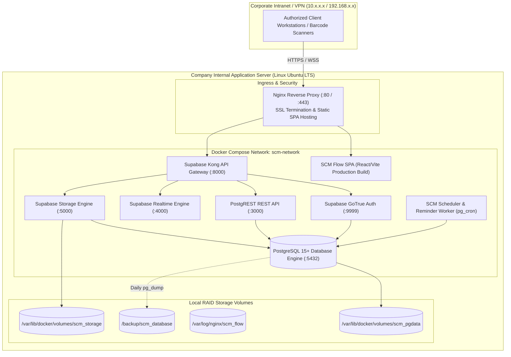

# SCM Flow — Enterprise Internal Deployment & Infrastructure Guide
**Document ID:** DEP-SCM-007  
**Version:** 1.0.0 (Phase 0 Baseline)  
**Status:** Approved for Implementation Planning  
**Target Environment:** Company Internal Enterprise Server (On-Premise / Intranet)  
**Containerization:** Docker & Docker Compose  
**Reverse Proxy:** Nginx with Internal Corporate SSL/TLS  

---

## 1. Internal Infrastructure Topology

SCM Flow is engineered for self-contained, air-gapped, or intranet-bound deployment on the company's internal server. No external cloud dependencies are required for operational execution.



---

## 2. Server Prerequisites & Hardware Sizing

### 2.1 Recommended Server Specifications
- **Operating System:** Ubuntu Server 22.04 LTS or 24.04 LTS (64-bit)
- **CPU:** 8 Cores (Intel Xeon or AMD EPYC)
- **RAM:** 32 GB ECC RAM (16 GB minimum for dev/staging)
- **Storage:** 500 GB NVMe / Enterprise SSD in RAID-1 or RAID-10 (for fast write latency and storage of COA PDFs and invoices)
- **Network:** 1 Gbps / 10 Gbps Internal Corporate LAN with static private IP address
- **Software Dependencies:** Docker Engine 24.0+, Docker Compose v2.20+, OpenSSL

---

## 3. Docker Compose Architecture

The application and backend services run under a unified `docker-compose.yml` configuration:

```yaml
version: '3.8'

networks:
  scm-network:
    driver: bridge

volumes:
  scm_db_data:
    driver: local
  scm_storage_data:
    driver: local

services:
  # ---------------------------------------------------------------------------
  # Database Tier: PostgreSQL 15 with pg_cron
  # ---------------------------------------------------------------------------
  db:
    image: supabase/postgres:15.1.0.117
    container_name: scm-postgres
    restart: always
    environment:
      POSTGRES_DB: postgres
      POSTGRES_PASSWORD: ${POSTGRES_PASSWORD}
      POSTGRES_HOST_AUTH_METHOD: scram-sha-256
      POSTGRES_INITDB_ARGS: "--auth-host=scram-sha-256 --auth-local=scram-sha-256"
      TZ: Asia/Kolkata
    volumes:
      - scm_db_data:/var/lib/postgresql/data
      - ./backend/supabase/schema.sql:/docker-entrypoint-initdb.d/01_schema.sql:ro
    networks:
      - scm-network

  # ---------------------------------------------------------------------------
  # API Gateway: Kong
  # ---------------------------------------------------------------------------
  kong:
    image: kong:2.8.1-alpine
    container_name: scm-kong
    restart: always
    environment:
      KONG_DATABASE: "off"
      KONG_DECLARATIVE_CONFIG: /var/lib/kong/kong.yml
      KONG_DNS_ORDER: LAST,A,CNAME
      KONG_PLUGINS: request-transformer,cors,key-auth,acl
    volumes:
      - ./backend/docker/kong.yml:/var/lib/kong/kong.yml:ro
    networks:
      - scm-network

  # ---------------------------------------------------------------------------
  # Auth Service: GoTrue
  # ---------------------------------------------------------------------------
  auth:
    image: supabase/gotrue:v2.132.3
    container_name: scm-auth
    restart: always
    environment:
      GOTRUE_JWT_SECRET: ${JWT_SECRET}
      GOTRUE_JWT_EXP: 86400
      GOTRUE_DB_DRIVER: postgres
      DATABASE_URL: postgres://postgres:${POSTGRES_PASSWORD}@db:5432/postgres?sslmode=disable
      GOTRUE_SITE_URL: ${APP_URL}
      GOTRUE_URI_ALLOW_LIST: ${APP_URL}/*
      API_EXTERNAL_URL: ${APP_URL}/auth/v1
    networks:
      - scm-network

  # ---------------------------------------------------------------------------
  # REST API: PostgREST
  # ---------------------------------------------------------------------------
  rest:
    image: postgrest/postgrest:v12.0.1
    container_name: scm-postgrest
    restart: always
    environment:
      PGRST_DB_URI: postgres://postgres:${POSTGRES_PASSWORD}@db:5432/postgres?sslmode=disable
      PGRST_DB_SCHEMAS: public,storage
      PGRST_DB_ANON_ROLE: anon
      PGRST_JWT_SECRET: ${JWT_SECRET}
    networks:
      - scm-network

  # ---------------------------------------------------------------------------
  # Storage Service: Supabase Storage
  # ---------------------------------------------------------------------------
  storage:
    image: supabase/storage-api:v0.43.11
    container_name: scm-storage
    restart: always
    environment:
      ANON_KEY: ${ANON_KEY}
      SERVICE_KEY: ${SERVICE_ROLE_KEY}
      POSTGREST_URL: http://rest:3000
      PGRST_JWT_SECRET: ${JWT_SECRET}
      DATABASE_URL: postgres://postgres:${POSTGRES_PASSWORD}@db:5432/postgres?sslmode=disable
      FILE_STORAGE_BACKEND_PATH: /var/lib/storage
      STORAGE_BACKEND: file
    volumes:
      - scm_storage_data:/var/lib/storage
    networks:
      - scm-network

  # ---------------------------------------------------------------------------
  # Frontend: Production Nginx SPA
  # ---------------------------------------------------------------------------
  frontend:
    build:
      context: ./frontend
      dockerfile: Dockerfile
    container_name: scm-frontend
    restart: always
    ports:
      - "80:80"
      - "443:443"
    environment:
      - VITE_SUPABASE_URL=${APP_URL}
      - VITE_SUPABASE_ANON_KEY=${ANON_KEY}
    volumes:
      - ./deploy/nginx/ssl:/etc/nginx/ssl:ro
      - ./deploy/nginx/scm.conf:/etc/nginx/conf.d/default.conf:ro
    networks:
      - scm-network
```

---

## 4. Reverse Proxy & Nginx Configuration

The frontend container serves the compiled React SPA and proxies API calls securely to the Kong gateway:

```nginx
# /etc/nginx/conf.d/default.conf
server {
    listen 80;
    server_name scm.company.internal;
    return 301 https://$host$request_uri;
}

server {
    listen 443 ssl http2;
    server_name scm.company.internal;

    ssl_certificate /etc/nginx/ssl/scm.crt;
    ssl_certificate_key /etc/nginx/ssl/scm.key;
    ssl_protocols TLSv1.2 TLSv1.3;
    ssl_ciphers HIGH:!aNULL:!MD5;

    # Client application static files
    root /usr/share/nginx/html;
    index index.html;

    # SPA routing fallback
    location / {
        try_files $uri $uri/ /index.html;
    }

    # Supabase Kong API routing
    location /api/ {
        proxy_pass http://kong:8000/;
        proxy_set_header Host $host;
        proxy_set_header X-Real-IP $remote_addr;
        proxy_set_header X-Forwarded-For $proxy_add_x_forwarded_for;
        proxy_set_header X-Forwarded-Proto https;
    }

    # Supabase Realtime WebSockets
    location /realtime/ {
        proxy_pass http://kong:8000/realtime/;
        proxy_http_version 1.1;
        proxy_set_header Upgrade $http_upgrade;
        proxy_set_header Connection "Upgrade";
        proxy_set_header Host $host;
    }

    # Upload file size limit (for batch COAs and multi-page invoices)
    client_max_body_size 50M;
}
```

---

## 5. Automated 3-Day Reminder Scheduler Configuration

To ensure the 3-day delivery reminder executes autonomously on the internal server without human intervention:

### 5.1 Option A: PostgreSQL `pg_cron` (Native In-Database)
```sql
-- Schedule daily job at 06:00 AM IST (which is 00:30 UTC)
SELECT cron.schedule(
    'dispatch_3day_delivery_reminders',
    '30 0 * * *',
    $$
    INSERT INTO public.notifications (recipient_user_id, notification_type, title, message, related_entity_type, related_entity_id)
    SELECT 
        po.created_by,
        'DELIVERY_REMINDER_3D',
        '3-Day Delivery Reminder: PO #' || po.po_number,
        'Shipment under PO #' || po.po_number || ' from ' || s.legal_name || ' is scheduled for delivery on ' || ds.promised_delivery_date || '.',
        'purchase_order',
        po.id
    FROM public.delivery_schedules ds
    JOIN public.purchase_orders po ON po.id = ds.po_id
    JOIN public.suppliers s ON s.id = po.supplier_id
    WHERE ds.status = 'scheduled'
      AND ds.reminder_sent = false
      AND ds.promised_delivery_date = (CURRENT_DATE + INTERVAL '3 days');

    -- Mark reminders as dispatched
    UPDATE public.delivery_schedules
    SET reminder_sent = true, reminder_sent_at = now(), status = 'reminder_dispatched'
    WHERE status = 'scheduled'
      AND reminder_sent = false
      AND promised_delivery_date = (CURRENT_DATE + INTERVAL '3 days');
    $$
);
```

---

## 6. Backup, Archival & Disaster Recovery

### 6.1 Daily Automated Backup Script (`/opt/scm/scripts/backup.sh`)
```bash
#!/bin/bash
set -e

BACKUP_DIR="/backup/scm_database"
DATE=$(date +'%Y%m%d_%H%M%S')
RETENTION_DAYS=30

mkdir -p $BACKUP_DIR

echo "[$(date)] Starting SCM Flow Database Backup..."
docker exec scm-postgres pg_dump -U postgres -F c -b -v -f /tmp/scm_backup_$DATE.dump postgres
docker cp scm-postgres:/tmp/scm_backup_$DATE.dump $BACKUP_DIR/scm_backup_$DATE.dump
docker exec scm-postgres rm /tmp/scm_backup_$DATE.dump

# Delete backups older than 30 days
find $BACKUP_DIR -name "scm_backup_*.dump" -type f -mtime +$RETENTION_DAYS -delete
echo "[$(date)] Backup completed successfully: $BACKUP_DIR/scm_backup_$DATE.dump"
```
Run via root crontab on the host server:
`0 2 * * * /opt/scm/scripts/backup.sh >> /var/log/scm_backup.log 2>&1`

