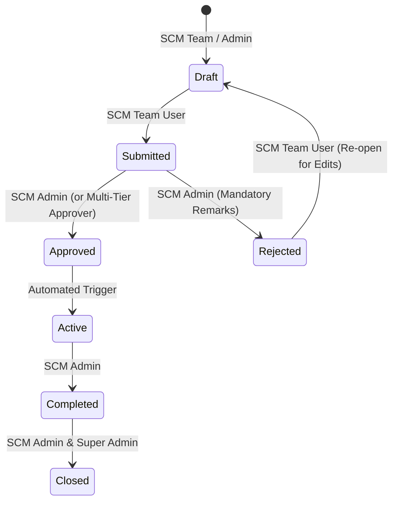
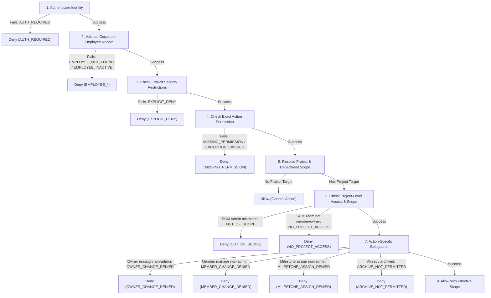

# SCM Flow — Role-Based Access Control & Permissions Matrix
**Document ID:** PRM-SCM-004  
**Version:** 2.0.0 (Phase 3 Route Authorization & Governance Baseline)  
**Status:** Approved Implementation Baseline  
**Enforcement Mechanism:** PostgreSQL Row Level Security (RLS), Centralized Server-Side RPCs, and React Route Guards  

---

## 1. Role Profiles & Operational Boundaries

| Role Identifier | Role Display Name | Primary Responsibilities & Scope |
| :--- | :--- | :--- |
| `super_admin` | **Super Admin** | Full platform administration, employee import and access governance, role assignment, global settings, tamper-evident audit-log access, and full SCM oversight. |
| `scm_admin` | **SCM Admin** | SCM operations and approved SCM configuration (`settings.scm.manage`); cannot create Super Admins, assign roles, import employees, or modify global system access controls. |
| `scm_team_user` | **SCM Team User** | Permitted SCM work within assigned departmental scope; cannot manage employees, roles, global settings, view audit logs, or view budgets/reports. |

---

## 2. Entity-Level CRUD Permissions Matrix

Legend:  
- **C:** Create / Insert  
- **R:** Read / Select (`All`: All records, `Dept`: Department-scoped, `Own`: Created/Assigned to user)  
- **U:** Update / Edit  
- **D:** Delete / Soft Delete  
- **—:** No Access / Prohibited  

| Domain Entity | Super Admin | SCM Admin | SCM Team User |
| :--- | :---: | :---: | :---: |
| **System Settings & Integrations** | C / R / U / D | R (Read-only) | — |
| **Audit Logs (`audit_logs`)** | R (Read-only) | — | — |
| **User Profiles & Role Assignment** | C / R / U / D | R (Read-only) | R (Own Profile) |
| **Departments** | C / R / U / D | R | R |
| **Material Masters Catalog** | C / R / U / D | C / R / U | R (Read-only) |
| **Supplier Registry (`suppliers`)** | C / R / U / D | C / R / U / D | R (Read-only) |
| **Projects (`projects`)** | C / R / U / D | C / R / U | C / R (All) / U (Own) |
| **Project Milestones (`milestones`)** | C / R / U / D | C / R / U / D | C / R (All) / U (Dept) |
| **Project Materials (BOM)** | C / R / U / D | C / R / U / D | C / R (All) / U (Dept) |
| **Approval Workflow Rules** | C / R / U / D | C / R / U | R (Read-only) |
| **Budget Requests** | C / R / U / D | R / Approve / Reject | C / R (All) / U (Draft only) |
| **Purchase Requisitions (PR)** | C / R / U / D | C / R / U / Approve | C / R (All) / U (Draft only) |
| **Purchase Orders (PO)** | C / R / U / D | C / R / U / Issue / Close | C (Draft) / R (All) / U (Draft) |
| **Supplier Confirmations** | C / R / U / D | C / R / U | C / R / U |
| **Delivery Schedules & Shipments** | C / R / U / D | C / R / U / D | C / R / U |
| **Goods Receipt Notes (GRN)** | C / R / U / D | C / R / U (QC Sign-off) | C / R / U (Draft/Quarantine) |
| **Supplier Invoices** | C / R / U / D | C / R / U / Match Sign-off | C (Entry) / R / U (Draft) |
| **3-Way Match Reconciliations** | C / R / U / D | C / R / U (Override Discrepancy)| R (Read-only) |
| **Project Closures** | C / R / U / D | C / R / U (Sign-off) | R (Read-only) |
| **Documents & Attachments** | C / R / U / D | C / R / U | C / R / U (Own Uploads) |
| **Notifications** | C / R / U / D | C / R / U (Own) | R / U (Own) |

---

## 3. State-Transition Authority Matrix

Strict business rules dictate who is authorized to transition an entity across its lifecycle states.

### 3.1 Project Lifecycle State Transitions
| From State | To State | Authorized Roles | Mandatory Preconditions |
| :--- | :--- | :--- | :--- |
| `draft` | `planned` | SCM Team User, SCM Admin | At least 1 milestone defined; start & end dates valid. |
| `planned` | `budget_approved`| Automated / SCM Admin | Related `budget_request` is formally approved. |
| `budget_approved`| `active` | SCM Admin | Approved budget > 0; first PR initiated. |
| `active` | `completed` | SCM Admin | All milestones marked completed; all GRNs accepted. |
| `completed`| `closed` | SCM Admin, Super Admin | `project_closures` audit checklist signed; variance reconciled. |
| Any (except `closed`)| `cancelled` | Super Admin, SCM Admin | Mandatory cancellation reason logged in audit trail. |

---

## 4. Phase 3 Canonical Route Authorization & Permission Matrix

### 4.1 Route-to-Permission Registry

| Route | Required Permission / Rule | Rule Mode | Super Admin | SCM Admin | SCM Team User |
| :--- | :--- | :---: | :---: | :---: | :---: |
| `/app/dashboard` | Authenticated active employee | Active Only | ✅ | ✅ | ✅ |
| `/app/profile` | `profile.view.self` | Single | ✅ | ✅ | ✅ |
| `/app/projects` | `projects.view` | Single | ✅ | ✅ | ✅ |
| `/app/materials` | `materials.view` | Single | ✅ | ✅ | ✅ |
| `/app/budgets-approvals`| `budgets.view` **OR** `approvals.view` | Any | ✅ | ✅ | ❌ |
| `/app/procurement` | `procurement.view` | Single | ✅ | ✅ | ✅ |
| `/app/deliveries` | `deliveries.view` | Single | ✅ | ✅ | ✅ |
| `/app/reports` | `reports.view` | Single | ✅ | ✅ | ❌ |
| `/app/admin/employees` | `employees.manage` | Single | ✅ | ❌ | ❌ |
| `/app/admin/imports` | `employees.import` | Single | ✅ | ❌ | ❌ |
| `/app/admin/audit-log` | `audit.view` | Single | ✅ | ❌ | ❌ |
| `/app/settings` | `settings.system.manage` **OR** `settings.scm.manage` | Any | ✅ | ✅ | ❌ |
| `/app/settings/system` | `settings.system.manage` | Single | ✅ | ❌ | ❌ |
| `/app/settings/scm` | `settings.scm.manage` | Single | ✅ | ✅ | ❌ |
| `/login`, `/signup`, `/forgot-password`, `/reset-password` | Public routes | Public | ✅ | ✅ | ✅ |
| `/403` | Authenticated active employee | Active Only | ✅ | ✅ | ✅ |
| `/404` | None | Public | ✅ | ✅ | ✅ |

---

## 5. Phase 4 Projects & Milestones Authorization Model

### 5.1 Granular Action Permissions

| Permission Code | Name / Purpose | Super Admin | SCM Admin | SCM Team User |
| :--- | :--- | :---: | :---: | :---: |
| `projects.view` | View project records within user's scope | ✅ | ✅ | ✅ |
| `projects.create` | Initiate a new project | ✅ | ✅ | ✅ |
| `projects.update` | Edit general project attributes | ✅ | ✅ | ✅ (Own/Member) |
| `projects.archive` | Archive a completed or obsolete project | ✅ | ✅ | ❌ |
| `projects.delete` | Hard delete project (restricted) | ✅ | ❌ | ❌ |
| `projects.view_all` | Bypass department/assignment boundaries | ✅ | ❌ | ❌ |
| `projects.manage_members`| Add/remove team members to/from project | ✅ | ✅ | ❌ |
| `projects.manage_owner` | Reassign project ownership | ✅ | ✅ | ❌ |
| `milestones.view` | View milestones for authorized projects | ✅ | ✅ | ✅ |
| `milestones.create` | Add new milestone to authorized project | ✅ | ✅ | ✅ (Own/Member) |
| `milestones.update` | Update milestone details | ✅ | ✅ | ✅ (Own/Member) |
| `milestones.complete` | Mark milestone as completed | ✅ | ✅ | ✅ (Own/Member) |
| `milestones.archive` | Archive milestone | ✅ | ✅ | ❌ |
| `milestones.assign` | Assign or reassign milestone owner | ✅ | ✅ | ❌ |

### 5.2 Centralized 9-Step Project Authorization Decision Algorithm

The authorization engine enforces the following exact sequence stopping at the first denial code:

### 5.3 Phase 4 Project Sub-Routes Registry

| Route Pattern | Required Permission | Description |
| :--- | :--- | :--- |
| `/app/projects` | `projects.view` | Paginated project list with status, delay, and progress indicators |
| `/app/projects/new` | `projects.create` | Project creation wizard with department & owner validation |
| `/app/projects/:projectId` | `projects.view` | Multi-tab project workspace (Overview, Milestones, Members, History) |
| `/app/projects/:projectId/edit` | `projects.update` | Project settings, lifecycle status modification, completion date entry |
| `/app/projects/:projectId/milestones` | `milestones.view` | Milestone WBS management, date tracking, and inline status updates |

---

## 6. Phase 6 Supplier Management Authorization & Governance Model

### 6.1 Granular Action Permissions

| Permission Code | Name / Purpose | Super Admin | SCM Admin | SCM Team User |
| :--- | :--- | :---: | :---: | :---: |
| `suppliers.view` | View supplier catalog, contacts, addresses, and qualification | ✅ | ✅ | ✅ |
| `suppliers.create` | Create new supplier master records | ✅ | ✅ | ❌ |
| `suppliers.update` | Update supplier master data and general details | ✅ | ✅ | ❌ |
| `suppliers.deactivate` | Deactivate active suppliers with mandatory reason | ✅ | ✅ | ❌ |
| `suppliers.reactivate` | Reactivate inactive suppliers with mandatory reason | ✅ | ✅ | ❌ |
| `suppliers.delete` | Permanently delete unreferenced suppliers with no dependencies | ✅ | ❌ | ❌ |
| `suppliers.view_all` | View all suppliers across all operational scopes and statuses | ✅ | ✅ | ❌ |
| `supplier_contacts.manage` | Create, update, and manage supplier contacts | ✅ | ✅ | ❌ |
| `supplier_addresses.manage` | Create, update, and manage supplier addresses | ✅ | ✅ | ❌ |
| `supplier_materials.view` | View supplier-material catalog associations | ✅ | ✅ | ✅ |
| `supplier_materials.manage` | Create, update, and deactivate supplier-material associations | ✅ | ✅ | ❌ |
| `supplier_documents.view` | View and download authorized supplier documents | ✅ | ✅ | ✅ |
| `supplier_documents.upload` | Upload supplier verification and quality documents | ✅ | ✅ | ❌ |
| `supplier_documents.archive` | Archive expired or obsolete supplier documents | ✅ | ✅ | ❌ |
| `supplier_qualification.view` | View supplier qualification status and review notes | ✅ | ✅ | ✅ |
| `supplier_qualification.update` | Update supplier qualification status with mandatory review notes | ✅ | ✅ | ❌ |

### 6.2 Phase 6 Supplier Sub-Routes Registry

| Route Pattern | Required Permission | Description |
| :--- | :--- | :--- |
| `/app/suppliers` | `suppliers.view` | Paginated supplier catalog with search, filters, and status badges |
| `/app/suppliers/new` | `suppliers.create` | Supplier registration wizard with server-side SUP-XXXXXX sequence |
| `/app/suppliers/:supplierId` | `suppliers.view` | Multi-tab supplier master (Overview, Contacts, Addresses, Materials, Documents, Qualification, Audit) |
| `/app/suppliers/:supplierId/edit` | `suppliers.update` | Master record editor with immutable supplier code |

### 6.3 Action-Specific Safeguards & Invariants

1. **Server-Generated Immutable Supplier Code:** Codes are generated via `SUP-` padded 6-digit sequence (`SUP-000001`) and protected against modification by database trigger.
2. **Permanent Deletion Safeguard:** Hard delete is blocked if any dependent contacts, addresses, material associations, documents, or qualification history records exist. Deactivation must be used instead.
3. **Mandatory Audit Reasons:** Deactivation, reactivation, and qualification transitions to `NOT_QUALIFIED` or `EXPIRED` require mandatory non-empty reasons/notes.
4. **Primary Entity Rules:** Exactly one active primary contact is enforced per supplier. At most one active primary address is enforced per address type per supplier.
5. **Inactive Supplier Boundary:** Inactive suppliers cannot be selected for new material associations, but remain visible in historical records.

1. **Default-Deny Authorization:** Missing mappings, unlisted actions, or unhandled routes result in immediate HTTP 403 / access denial. Direct URL navigation cannot bypass server-side or frontend route guards.
2. **Workflow-Based Approval Authority:** Approval permissions must be assigned through the relevant workflow step configuration (`public.approval_workflow_steps`), never inferred from a user's role, department, or designation.
3. **Denial of Self-Approval:** PostgreSQL RPC `public.check_can_approve(p_step_id, p_requester_id)` strictly denies self-approval (`v_user_id != p_requester_id`).
4. **Inactive Employee Boundary:** If `employees.is_active` is `false`, all RLS policies, RPCs, and route guards immediately reject access regardless of JWT token expiration.
5. **Conditional Section Rendering:** On `/app/budgets-approvals`, users only see sections for which they hold explicit permissions (`budgets.view` or `approvals.view`). On `/app/settings`, only permitted settings cards (`settings.system.manage` or `settings.scm.manage`) are displayed.
