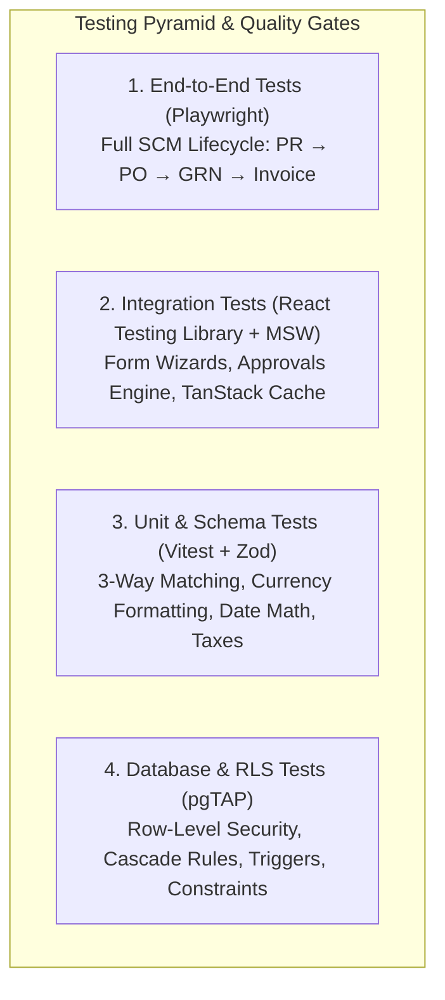

# SCM Flow — Comprehensive Quality Assurance & Testing Strategy
**Document ID:** TST-SCM-008  
**Version:** 1.0.0 (Phase 0 Baseline)  
**Status:** Approved for Implementation Planning  
**Testing Frameworks:** Vitest, React Testing Library, Playwright, pgTAP, Zod Schema Assertions  

---

## 1. Testing Philosophy & Quality Pyramid

SCM Flow manages capital-intensive procurement, legal purchase orders, pharmaceutical/chemical quality releases, and financial tax invoices. Defects in financial calculations or unauthorized status transitions directly impact statutory compliance and cash flow.



---

## 2. Test Layer Specifications

### 2.1 Layer 1: Unit & Schema Validation (Vitest)
- **Scope:** Pure functions, financial math, currency formatters, date evaluation, and Zod schemas.
- **Key Test Suites:**
  - **Financial Math (`src/lib/__tests__/finance.test.ts`):**
    - GST calculation with exact precision (e.g., $18\%$ on ₹ $1,25,432.50$).
    - Elimination of IEEE 754 floating-point drift ($0.1 + 0.2 \ne 0.30000000000000004$).
    - Indian numbering system format testing (`formatIndianRupee(1250000)` $\to$ `₹ 12,50,000.00`).
  - **Date Math & 3-Day Reminder Evaluator (`src/lib/__tests__/date-math.test.ts`):**
    - Verify that `promised_delivery_date - 3 days` matches exactly across month boundaries, leap years, and daylight savings invariants in `Asia/Kolkata`.
  - **Zod Schema Tests (`src/features/*/schemas.test.ts`):**
    - Rejection of invalid GSTIN patterns.
    - Rejection of non-positive material quantities.
    - Validation that milestone target dates cannot precede project start dates.

### 2.2 Layer 2: Component & Integration Testing (React Testing Library + MSW)
- **Scope:** Interactive components, multi-step wizards, slide-over drawers, and TanStack Query state caching.
- **Key Test Scenarios:**
  - **Multi-Step PO Wizard:**
    - Test drafting with 3 line items.
    - Assert that changing item quantity updates subtotal, GST, and grand total dynamically.
    - Assert that exceeding project `approved_budget` displays a blocking error alert.
  - **Managerial Approval Queue:**
    - Verify that approving a step triggers optimistic UI update and invalidates the pending queue cache.
    - Verify that rejecting a step requires entering mandatory comments before the "Submit Rejection" button becomes clickable.
  - **3-Way Match Verification Drawer:**
    - Render matched invoice; assert green "Exact Match" badge.
    - Inject variance ($\Delta Q = +5 \text{ KG}$); assert red "Quantity Discrepancy Held" badge and disabled payment clearance button.

### 2.3 Layer 3: Database & Row-Level Security Testing (pgTAP)
- **Scope:** Direct PostgreSQL schema, constraint enforcement, and RLS role isolation.
- **pgTAP Test Suite (`backend/tests/rls_test.sql`):**
  ```sql
  BEGIN;
  SELECT plan(8);

  -- Test 1: Verify RLS is enabled on all tables
  SELECT tables_are('public', ARRAY[
      'projects', 'milestones', 'project_materials', 'purchase_orders', 
      'goods_receipt_notes', 'invoices', 'audit_logs'
  ]);

  -- Test 2: SCM Team User cannot update approved_budget directly
  SET ROLE authenticated;
  SET request.jwt.claim.sub = '00000000-0000-0000-0000-000000000003'; -- Team user UUID
  
  PREPARE update_budget AS 
      UPDATE public.projects SET approved_budget = 9999999 WHERE project_code = 'PRJ-2026-001';
  SELECT throws_ok('update_budget');

  -- Test 3: Audit log immutability
  PREPARE delete_audit AS DELETE FROM public.audit_logs;
  SELECT throws_ok('delete_audit');

  SELECT * FROM finish();
  ROLLBACK;
  ```

### 2.4 Layer 4: End-to-End User Journey Testing (Playwright)
- **Scope:** Headless browser automation testing the complete 11-stage procurement workflow across user roles.
- **Critical Golden Path E2E Test (`e2e/complete-procurement-lifecycle.spec.ts`):**
  1. **User `team_user` signs in:**
     - Creates new Project `PRJ-E2E-001` in Formulations Department.
     - Adds Milestone 1 (Pilot Synthesis) and assigns 500 KG API Paracetamol IP.
     - Submits Budget Request for ₹ 2,50,000.
  2. **User `scm_admin` signs in:**
     - Views pending approval queue.
     - Approves Budget Request for ₹ 2,50,000.
  3. **User `team_user` creates PR & PO:**
     - Requisitions 500 KG material.
     - Creates PO to Apex Chemicals at ₹ 500/KG + 18% GST (Total: ₹ 2,95,000).
  4. **User `scm_admin` issues PO:**
     - Reviews and signs off PO. Status becomes `issued`.
  5. **User records Supplier Confirmation & 3-Day Reminder trigger:**
     - Enters vendor acknowledgment with promised delivery date $T + 3$ days.
     - Runs reminder worker; verifies notification received.
  6. **Consignment arrives at Gate (GRN):**
     - Records Gate Entry # GE-901, received qty 500 KG.
     - Enters Batch # BX-491, attaches mock COA, marks QC `accepted`.
  7. **Invoice Registration & 3-Way Match:**
     - Submits Vendor Invoice # INV-8812 for ₹ 2,95,000.
     - Matching engine reports `exact_match`. SCM Admin signs off.
  8. **Project Closure:**
     - Project variance calculated; closure checklist signed; project archived.

---

## 3. Financial Calculation & Rounding Precision Policy

Financial calculations adhere to IEEE 754-safe rules:
- All database computations use `NUMERIC(15, 2)` for currency and `NUMERIC(12, 3)` for quantities.
- The UI uses exact integer cents/paise or BigNumber utilities (`decimal.js`) before rendering string formats.
- 3-Way Matching tolerances:
  $$\begin{aligned}
  |\text{Billed Qty} - \text{Accepted Qty}| &< 0.001 \\
  |\text{Billed Amount} - \text{Calculated PO Value}| &< 0.01 \text{ INR}
  \end{aligned}$$

---

## 4. CI/CD Quality Gates & Release Criteria

For any code to be promoted to the internal production server, all gates must pass:

| Gate | Tool / Check | Threshold Required |
| :--- | :--- | :--- |
| **Linting & Formatting** | ESLint + Prettier | 0 Errors, 0 Warnings |
| **Type Integrity** | TypeScript (`tsc --noEmit`) | 0 Type Errors |
| **Unit Test Coverage** | Vitest (`v8` provider) | > 85% Statements, > 90% Financial Utils |
| **E2E Critical Flow** | Playwright | 100% Passing on Golden Procurement Path |
| **Security Audit** | npm audit / Snyk | 0 High or Critical Vulnerabilities |

